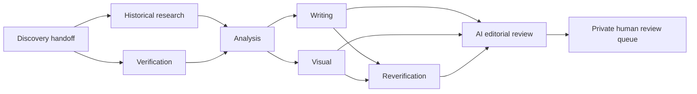

# Stage 5A fixture newsroom

GL-AGENT-001 coordinates the newsroom through PostgreSQL transitions and Cloudflare Workflows. The eight-agent registry supplies the role identities. The seven specialist stages use synthetic handoffs and the OpenAI adapter uses an in-process Responses-format transport.

## Discovery and priority

The existing 15-minute cron dispatches discovery and the fixture newsroom when their local modes are enabled. Successful fixture discovery also dispatches an immediate scan. A scan accepts ranked, eligible fixture discovery with an unrevoked acquisition licence and excludes restricted pilot events. It reassesses a lead after 30 minutes or when ingestion supplies a new rank or changes the underlying score inputs or source independence.

The ranking uses public impact (30%), evidence strength (25%), urgency (20%), regional relevance (15%), and historical significance (10%). The initial bands start at 85 for Critical, 70 for High, 55 for Standard, and 40 for Monitor. Lower scores are Archive. Each assessment records a separate verification-attention flag when impact is at least 75 and evidence is below 50 or fewer than two independent origins are known. Standard and higher leads and verification-attention leads can each open one fixture workflow per event. The rank controls intake and priority. Verification and reverification still have to complete.

A ranked event retains the discovery rank ID, which links it to ingestion history. The task envelope carries the event ID, the verification-attention flag, and validated synthetic outcomes from completed prerequisites. The launch target of five fully researched stories per day is an editorial target. Fixture discovery and priority assessment operate continuously.

## Workflow and execution



A revision request supplies context to the next writing or visual task, follows the latest version of the other task, and reruns reverification and editorial review. The Orchestrator allows two automated revisions each for writing and visual work. An incomplete or critical finding, exhausted attempts, a stalled dependency graph, or exhausted revisions escalates to the private queue. Escalation and explicit cancellation fence outstanding work.

PostgreSQL locks the fixture workflow row for each story so that no more than three attempts hold leases concurrently. Every lease has an attempt UUID and can start once. It expires after 180 seconds for standard work or 300 seconds for historical research and visual work. A lost lease or failed technical execution is eligible again after 5 seconds and then 30 seconds, with three attempts total. Workflows persist their steps and wait until the database reports eligibility. A later scan can recover interrupted work.

Markdown prompts in `prompts/newsroom` have per-agent versions. The build embeds the prompts and their SHA-256 digests. The registry retains older versions for existing tasks. A scan rejects a changed digest for an existing version. The intake pins the model, token caps, and simulated rates. Ajv validates the Draft 2020-12 task and output contracts, including the context checks in the execution engine. PostgreSQL independently checks dispositions and token limits before writing results.

## Database and security

- [20261120000700_newsroom_model.sql](../../supabase/migrations/20261120000700_newsroom_model.sql) adds a fixture policy, stage definitions, rank assessments, dependency edges, and fixture fields on existing workflow, task, attempt, and usage tables. Composite foreign keys keep fixture and sealed-version records from mixing.
- [20261120000800_newsroom_transitions.sql](../../supabase/migrations/20261120000800_newsroom_transitions.sql) defines scoped intake, claim, start, settlement, cancellation, status, budget, and review-queue RPCs. The attempt and run transitions write structured audit events. Per-attempt status includes timing, failure, and token and cost observations.
- The dedicated `newsroom_operator` role can operate fixtures. The private human review queue requires an AAL2 Human Editor session. Fixture workflows have a synthetic story and no sealed version. Editorial reviews, exact-version approval, publication, rights, and privacy gates retain their existing authorization paths.
- A claim holds the discovery ledger row for the current UTC month while it reserves maximum simulated token cost. The development check combines observed discovery costs with fixture estimates and outstanding holds. Completion settles the estimate to measured mock usage. Failure after starting retains the simulated maximum, and cancellation before starting releases the hold. Actual fixture charges are zero. The configured ceilings are USD 50 for development and USD 300 for launch. Stage 5A admits only development fixtures.

The local policy is seeded by migration and can be tuned by the disposable database administrator. App users and operators cannot change the policy. The Worker starts with `NEWSROOM_MODE=disabled`. Local fixture execution requires an explicit `fixture` mode, a database URL of `http://127.0.0.1:54321`, and a scoped operator session. Keep the operator JWT in ignored local credentials.

## Verification

Run the regression commands below after starting local Supabase and configuring the test environment described in [local development](../operations/development.md).

```sh
supabase db reset --local
npm run check
npm run test:browser
npm run ingestion:dry-run
npm run test:database
npm run test:workflow
```

The reset applies to a disposable local database. The database suite uses synthetic identities and tests races in real PostgreSQL. The Workerd suite starts a loopback preview using temporary credentials, dispatches Cron, and checks a fixture handoff to the private human queue.

Later stages cover specialist agent behavior, claim and evidence production, and integrated review against sealed versions. Live OpenAI model benchmarking and provider execution require separate authorization. Live GDELT and World Bank activation remain release requirements subject to destination security validation.
