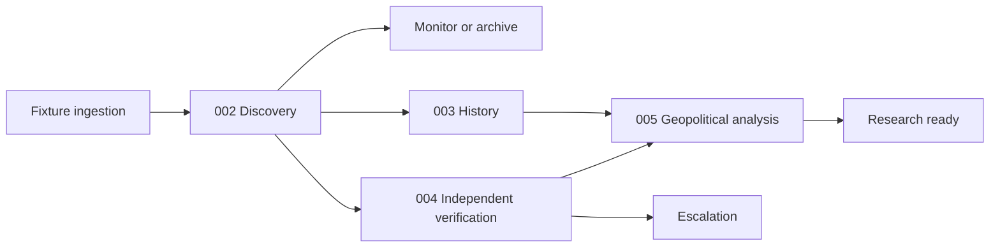

# Stage 5B research fixture workflow

Stage 5B connects licensed synthetic ingestion records to the four research agents. Enable it locally with `NEWSROOM_MODE=research-fixture` and the fixture database bindings from [Stage 5A](newsroom-stage-5a.md). The repository configuration defaults to `disabled`. The `fixture` mode continues to support the Stage 5A regression workflow.



The Orchestrator uses the same concurrency, lease, failure, retry, cancellation and atomic budget transitions as Stage 5A. The research graph schedules four roles. Monitoring and archive dispositions settle after discovery. Verified material claims and the historical handoff are both required before analysis. A critical verification finding blocks downstream work and stays in the private escalation queue. A completed package ends in `research_ready`.

## Agents and contracts

- **GL-AGENT-002** reads the existing discovery event, source attribution, classification and score components. It merges duplicate and syndicated reports by origin, URL and fingerprint. It assigns Nigeria, Africa or global scope from ingested locations, flags source gaps and returns a triage recommendation using the approved weights. When multiple scopes overlap the output retains every ingested location.
- **GL-AGENT-003** selects contextual, extended or deep coverage. In the fixture workflow the historical ranking component selects extended at 40 and deep at 75. The depth changes which archived evidence is considered. Relevant earlier records and uncertain ranges retain their supplied dates, including years before the common era and undated records.
- **GL-AGENT-004** breaks annotated compound source statements into claim-level records and compares numbers and units, calendar dates, quotations and attribution with the relevant excerpts. It tracks current, contradictory and excluded evidence, checks known origin before crediting corroboration, and records mixed claims and outdated information independently of their internal verdict. Public FactCheck labels have a separate editorial workflow.
- **GL-AGENT-005** uses the historical and verification results to separate verified factual claims from documented objectives, inferred intentions and assumptions. It records conditional baseline, alternative and escalation scenarios, with evidence, early warnings and the default horizons of 0–3, 3–12 and 12–36 months. A missing scenario remains open and prevents the package from reaching research-ready status.

The v2 prompts are under `prompts/newsroom`. Each role has a Draft 2020-12 input and output schema in `src/schemas/newsroom`. The fixture engine validates the task identity and requires the mock result to agree with the annotated packet. Instructions inside source excerpts remain data. The adapter has no network transport, credentials, or publication tools.

## Persistence and access

[The Stage 5B migration](../../supabase/migrations/20261120000900_newsroom_research.sql) adds immutable synthetic evidence excerpts tied to ingested event documents, private findings, and foreign-keyed source and evidence links. Existing workflow and attempt rows hold the task identity and pinned inputs. The specialist RPC accepts one finding per stage and rechecks licence eligibility at settlement. Scope checks tie citations to the current attempt's packet or, for analysis, its accepted prerequisite citations. The verification gate also checks for current contradictions when a result is submitted as verified.

The `newsroom_research_findings` RPC returns the findings, source metadata and evidence locators to the scoped operator or an MFA-authenticated Human Editor. Approved sealed-version editorial rules and public access continue through the existing editorial service. The fixture workflow produces no sealed article or publication.

Research leases reserve simulated cost under the existing development limit with up to 12,288 input and 4,096 output tokens per attempt. Mock estimates are based on text length. The packet bounds are 24 licensed documents and 48 evidence records per role. Oversized packets fail validation and follow the existing retry and escalation policy. The fixture records have zero actual provider cost.

## Local verification

Run these commands with the disposable local Supabase stack and test prerequisites from [local development](../operations/development.md).

```sh
supabase db reset --local
npm run check
npm run test:database
npm run test:workflow
npm run test:browser
npm run ingestion:dry-run
```

The database and Workerd tests load clearly labelled examples through the existing ingestion RPC and attach curated synthetic excerpts. The test scenarios exercise independently corroborated claims, conflicting evidence, unsupported sensitive allegations and licence revocation.

The fixture implementation relies on curated annotations for claim segmentation and sourcing. Live extraction, archive retrieval, provider benchmarking, and editorial use of the research package require later approval and validation.
