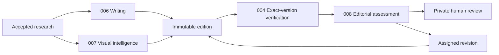

# Stage 5C private fixture editions

Stage 5C starts with an existing Stage 5B run in `research_ready`. A scoped newsroom operator calls `queue_newsroom_edition` with the run ID and the generated prompt manifest. The queue accepts one edition run per research handoff. Set the local Worker to `NEWSROOM_MODE=editorial-fixture` to claim queued editions. The committed Worker configuration defaults to `disabled`.



## Drafts and assets

GL-AGENT-006 builds the Quick Brief and Deep Dive for the same story and source register. An operator can select one additional format from Historical Explainer, Geopolitical Analysis, Investigative Report, Special Feature and FactCheck Report. Ordered article sections carry the story and research identifiers, three headline options, a standfirst, the measured word count, and labelled paragraphs with claim and evidence references. The writer uses accepted Stage 5B research material and original editorial context. The source and evidence registers resolve each reference to the original attribution and locator.

Each draft includes a search title and description, grounded categories and tags, and a private social summary. The database validates them against the pinned headline, standfirst and discovery classification. The writing factor considers the selected formats’ advisory length ranges.

| Format | Advisory words |
|---|---:|
| Quick Brief | 150–300 |
| Deep Dive | 900–1,500 |
| Historical Explainer | 800–1,500 |
| Geopolitical Analysis | 1,000–1,800 |
| Investigative Report | 1,500–3,000+ |
| Special Feature | 1,200–2,500 |
| FactCheck Report | 500–900 |

A proposed factual addition is recorded outside the draft body and sent to GL-AGENT-004. Unresolved proposals hold the edition pending eligible evidence. Structured validation checks the source-bound paragraphs, headlines and standfirst before accepting the draft.

GL-AGENT-007 assembles maps, charts, timelines, infographics, relationship diagrams, licensed photo references, and disclosed mock AI illustration references. Each new record carries a title, purpose, caption, alternative text, uncertainty, rights terms and expiry, provenance, version, and source references. Its pinned data snapshot includes the version digest, UTC capture time, and a source observation date when available. The Worker emits GeoJSON point records for MapLibre with Stadia tiles disabled, zero-based statistical chart specifications, and responsive layout metadata using the reader’s `--ink` and `--accent` design tokens. The payload provides text and data for accessible rendering. Fixture media objects live in the existing private storage bucket.

Visual records come from a curated synthetic catalogue with evidence references. Chart values and units are checked against verified numeric claims, and timeline ranges and certainty are checked against accepted history. Missing, expired or revoked rights block the asset. Version checks and rights checks cover the exact media object, captions and referenced source records.

The visual rubric weights factual and data accuracy at 30%, geographical accuracy at 20%, clarity at 15%, editorial relevance at 10%, accessibility at 10%, attribution and licensing at 10%, and brand consistency at 5%. For maps, coordinates and uncertainty disclosures inform the geographical score. For visuals that do not encode geography, the geographical rating is null and the score divides by the remaining 80% of applicable weight. Clarity and accessibility consider descriptive copy and alternative text, relevance requires an accepted evidence link, and brand consistency uses the fixture’s fixed reader tokens. A visual must reach 85 and clear the accuracy, security and licensing gates. The database recomputes this outcome at settlement.

## Review and authority

The database seals both accepted outputs and their references into an immutable edition with a SHA-256 digest. GL-AGENT-004 and GL-AGENT-008 use that exact edition. Reviews preserve the digest, decision, score, findings, and instructions. The AI Editor-in-Chief applies the approved eight weights and the 85-point threshold. Critical grounding, rights, source independence, security or privacy failures block handoff regardless of the score.

A revision identifies the affected claim, section or visual, the problem, evidence or evidence gap, responsible agent, required correction and publication impact. The responsible writing or visual agent receives the structured corrections with its next lease. The existing workflow retires the prior edition as the current version, enforces two automated revisions per affected stage, and orders fresh verification and review against the next digest. The historical versions and assessments remain available to authorized users.

The `newsroom_edition` RPC is scoped to operators and MFA-authenticated human editors. Its `readyForHumanReview` field rechecks current rights. Stage 5C ends at private `human_review` or escalation. The existing public editorial path retains exact-version human approval and human publisher authority. [Editorial security migration](../../supabase/migrations/20261120000300_editorial_security.sql)

## Database and local verification

- The edition model adds immutable products, versions, reviews, and fixture visual records with row-level access controls. [Model migration](../../supabase/migrations/20261120001000_newsroom_editions.sql)
- The workflow migration adds the scoped queue and read RPCs, reuses the existing leases and revision limits, and checks source and media rights when results settle. [Workflow migration](../../supabase/migrations/20261120001100_newsroom_edition_workflow.sql)
- The requirements migration adds metadata to the existing visual catalogue and lease packets. It validates draft metadata, scores visuals, and records structured corrections. Earlier sealed payloads and digests retain their recorded shape. [Requirements migration](../../supabase/migrations/20261120001200_newsroom_editorial_requirements.sql)

The local regression uses curated fixture geometry, structured visual records, private placeholder media, and in-process mock responses. It reserves simulated usage under the existing development budget. Each editorial attempt is capped at 28,672 input tokens and 8,192 output tokens. Recorded provider spend is zero. Editorial browsing, actual image generation and hosted tile rendering require separate implementation and review.

Start the disposable Supabase stack using the local development instructions, then run the checks below. The editorial integration and Workerd tests build an accepted research handoff with the existing fixture utilities. [Local development](../operations/development.md)

```sh
supabase db reset --local
npm run check
npm run test:database
npm run test:workflow
npm run test:browser
npm run ingestion:dry-run
```

## Stage 5D handoff

Stage 5D can use the accepted research run ID to queue the Stage 5C edition, then consume its exact version ID, digest, evidence register, verification and editorial review history at the private handoff. Integration acceptance should cover retries and duplicate work, fresh approval checks after changes, expired rights, critical findings and the authenticated human publication boundary. The operational target of five stories per day stays subordinate to those checks.
