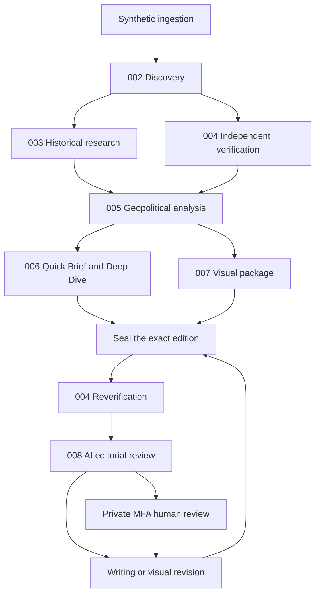

# Integrated synthetic newsroom

`NEWSROOM_MODE=integrated-fixture` runs one investigation from ranked synthetic ingestion to a private human decision. This local mode requires the loopback Supabase API and a scoped `newsroom_operator` session. The repository defaults to `NEWSROOM_MODE=disabled` and `DISCOVERY_MODE=disabled`.



GL-AGENT-001 drives this graph through Cloudflare Workflows and PostgreSQL. Discovery classifies and ranks the event. Historical research and verification can run in parallel. Analysis needs both. Writing and visual work can also run in parallel. Reverification requires both products and binds to their sealed digest. The AI Editor-in-Chief reviews that exact edition. Critical findings escalate for further investigation and stop downstream work.

The 15-minute Cron or a completed fixture discovery triggers intake. The scan reuses the existing ranking and prompt manifest. It includes paused `research_ready` runs and active editions when work is eligible. The run lock orders the research-to-edition transition, so racing workers create the edition once. A new worker can resume with the same database run ID. The earlier `fixture`, `research-fixture`, and `editorial-fixture` modes still support their individual regression paths.

The existing task engine enforces three concurrent leases per story, three technical attempts, and 5- and 30-second retry delays. History and visual work have 300-second leases. Other stages have 180 seconds. Atomic reservations include discovery spend and synthetic estimates under the $50 development ceiling. The commercial monthly policy remains capped at $300. All fixture attempts record zero actual provider spend.

## Revisions and human decisions

An eligible AI recommendation opens the private review queue. Minor and major feedback routes to the responsible writer or visual agent and preserves structured issues with their source version. A revised product seals a new digest and repeats verification and AI review. Each stage has two revision slots. The fixture shares those slots with human returns. A request after the cap escalates with the earlier editions and findings intact.

`newsroom_fixture_review_queue` requires an MFA-authenticated Human Editor. `newsroom_edition` provides the current version ID, digest, exact article, source and evidence register, visual assets, captions, and both review records. It also returns `currentDecision`, `approvalCurrent` and the private `humanActions` history.

`review_newsroom_edition` takes the run ID, current version ID, expected digest and an operation UUID. An MFA-authenticated Human Editor may approve, reject with a reason, or return the edition to writing or visual work with a correction. The database binds each action to both successful reviews, checks active rights before approval, and records the reviewer. Replaying the same operation returns its historical action ID. The current edition and live rights determine whether the approval is still effective. Approving or rejecting removes the decided edition from the pending queue. A return closes the old version and opens a fresh decision after re-review.

The private fixture decision authorizes only the synthetic review outcome. Its version IDs are absent from the public editorial version table. The existing publication path retains separate MFA human approval and publisher roles, exact-version review checks, rights checks and idempotency. The reader preview continues to use its separate labelled fixture catalogue. [Editorial security](database-security.md)

## Reproduce the demonstration

Use the disposable local Supabase stack and Node prerequisites. Install the Chromium browser required by the Playwright configuration before running the browser suite. [Local development](../operations/development.md) · [Supabase prerequisites](database-security.md#local-only-validation)

```sh
supabase db reset --local
npm run check
npm run test:database
supabase db reset --local
npm run test:workflow
npm run demo:newsroom
npm run test:browser
npm run ingestion:dry-run
```

The demo provisions synthetic identities and processes curated evidence and a chart through the existing ingestion adapters and local Workerd. It reaches the actual private queue with an MFA reviewer and prints the event ID, workflow run ID, edition ID, digest and attempt count. The integration suite covers all acceptance scenarios alongside the earlier database and browser regressions. The two local resets isolate the suites because the database ingestion assertions count clusters in the shared fixture database.

Audit records include the integration handoff, lease and attempt events, validated research findings, immutable editorial products, versioned reviews, revision requests and human actions. `newsroom_fixture_status` exposes scoped task and usage summaries. The local database administrator can match `governance.audit_events.target_id` to the run, attempt, edition or action ID. [Integration migration](../../supabase/migrations/20261120001300_newsroom_integration.sql)

## Release requirements

- Authorize and benchmark live OpenAI execution, then validate real usage, cost and output quality against the approved controls.
- Securely validate destination IPs and rights before activating GDELT or World Bank. Premium Times remains disabled pending permissions and separate approval.
- Review a trusted production handoff from an authorized edition into the sealed publication path, including real source permissions, Storage bindings and public reader delivery.
- Validate real visual production, hosted tiles, hosted identity and deployment in their separately approved scopes. The five-story daily target remains unmeasured under live operating conditions.
